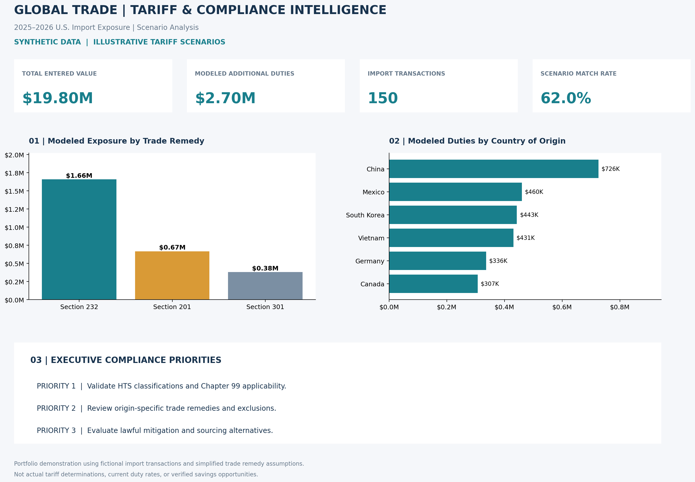

# Global Trade | Tariff & Compliance Intelligence

### Python Analytics • International Trade Compliance • Executive Decision Support

**Turning global trade data into actionable business intelligence.**

This portfolio project demonstrates how Python can support international trade compliance, tariff exposure analysis, and data-driven business decisions.

Using synthetic import transactions and illustrative Section 201, 232, and 301 tariff scenarios, the analysis identifies potential duty exposure, prioritizes compliance reviews, and translates financial data into executive-level insights.

**Core skills:** Python • pandas • Data Validation • Trade Remedy Screening • Financial Modeling • Executive Dashboards

> **PORTFOLIO SIMULATION NOTICE**
>
> All transaction data is synthetic, and tariff assumptions are hypothetical. The modeled Section 201, 232, and 301 rates do not represent verified historical or current U.S. tariff treatment. Results are illustrative and should not be used to determine actual customs liability or compliance requirements.

---

## 1. Tariff & Compliance Intelligence | 2025–2026



**Executive snapshot:** 150 synthetic import transactions, 93 illustrative tariff scenario matches, and approximately **$2.70 million in modeled additional duty exposure**.

### Key Performance Indicators

| Metric | Result |
|---|---:|
| Import Transactions Analyzed | 150 |
| Total Entered Value | $19,796,679.82 |
| Transactions Matching Tariff Scenarios | 93 |
| Scenario Match Rate | 62% |
| Modeled Additional Duty Exposure | $2,702,835.93 |

### Modeled Exposure by Trade Remedy Program

| Program | Matched Entries | Modeled Additional Duties |
|---|---:|---:|
| Section 232 | 48 | $1,656,909.13 |
| Section 201 | 32 | $666,667.76 |
| Section 301 | 13 | $379,259.04 |

Under the illustrative assumptions, Section 232 accounts for the largest share of modeled additional duty exposure.

### Compliance Review Prioritization

The screening model evaluates all 150 transactions and assigns review priorities to entries matching the hypothetical tariff rules.

| Review Priority | Transactions | Illustrative Threshold |
|---|---:|---|
| High | 53 | Modeled additional duties ≥ $25,000 |
| Medium | 24 | $10,000 to under $25,000 |
| Low | 16 | Under $10,000 |
| Not Assessed | 57 | No illustrative scenario match |

These classifications represent **financial review priorities**, not confirmed compliance violations. An unmatched transaction is not necessarily duty-free or compliant.

### Business Implications

**Focus compliance resources.** Prioritize higher-exposure transactions for further review while retaining visibility into entries that did not match the simplified tariff rules.

**Strengthen tariff governance.** Validate HTS classifications, Chapter 99 provisions, country-of-origin documentation, trade remedy scope, effective dates, and applicable exclusions.

**Support strategic sourcing decisions.** Use illustrative landed-cost comparisons to explore sourcing alternatives while accounting for supplier pricing, freight, origin qualification, and actual tariff treatment.

---

## 2. Historical Global Trade Analysis | 2022–2024


The original analysis examines synthetic import and export activity across China, Canada, Mexico, and Germany.

It demonstrates:

- Annual import and export trend analysis.
- Country-level trade comparisons.
- Trade balance calculations.
- Import share analysis.
- Executive data visualization.

This component provides broader global trade context alongside the transaction-level tariff compliance analysis.

---

## 3. Trade Compliance Methodology

### Data Validation

Python checks required transaction fields, duplicate entry identifiers, and positive entered values before performing scenario analysis.

### Illustrative Tariff Screening

Synthetic import entries are compared against a separate tariff rules table using product category, country of origin, entry date, and hypothetical effective dates.

The model calculates:

**Modeled Additional Duty = Entered Value × Illustrative Additional Duty Rate**

Results are summarized by trade remedy program and country of origin.

### Compliance Risk Screening

A transaction-level report identifies illustrative tariff matches, financial review priorities, and transactions without a scenario match.

The screening process supports review prioritization but does not establish legal applicability or actual customs liability.

### Landed-Cost Scenario Analysis

A simplified hypothetical sourcing example compares product value, additional duty assumptions, and freight costs.

The example demonstrates how changes in sourcing assumptions can affect modeled landed cost. It does not establish actual tariff savings, and alternative sourcing requires verification of origin, duty treatment, and commercial feasibility.

### Regulatory Limitations

Actual U.S. tariff applicability requires product-specific review of HTS classifications, Chapter 99 provisions, country-of-origin rules, exclusions, effective dates, duty interactions, and other applicable requirements.

The scenario model is not a legally validated tariff determination engine.

---

## 4. Technology Stack

| Technology | Application |
|---|---|
| Python | Automated analysis and financial modeling |
| pandas | Data validation, matching, aggregation, and screening |
| Matplotlib | Executive dashboard visualization |
| CSV | Synthetic transaction data, tariff assumptions, and reports |
| GitHub | Version control and portfolio presentation |

---

## 5. Repository Structure

```text
Global-Trade-Data-Analysis/
├── README.md
├── requirements.txt
├── analysis.py
├── dashboard.py
├── trade_data.csv
├── trade_dashboard.png
├── generate_import_data.py
├── import_entries.csv
├── tariff_rules.csv
├── tariff_analysis.py
├── tariff_intelligence_dashboard.png
├── tariff_scenario_matches.csv
├── tariff_program_summary.csv
├── tariff_country_exposure.csv
├── tariff_category_exposure.csv
└── compliance_risk_report.csv

```

---

## 6. How to Run the Project

Install the required Python dependencies:

```bash
python3 -m pip install -r requirements.txt
```

Generate the reproducible synthetic import transactions:

```bash
python3 generate_import_data.py
```

Run the tariff scenario analysis:

```bash
python3 tariff_analysis.py
```

The script generates analytical reports and the tariff intelligence dashboard in the local `outputs/` folder.

The original historical trade analysis is maintained in `analysis.py` and `dashboard.py`.

---

## 7. Professional Application

This project demonstrates capabilities relevant to:

- International trade compliance and customs analytics.
- Tariff exposure assessment and trade remedy screening.
- Procurement and strategic sourcing analysis.
- Financial risk prioritization.
- Executive reporting and business intelligence.

**Executive takeaway:** Python-based screening and financial analysis can help trade compliance teams organize review priorities, communicate potential exposure, and support more informed business decisions.

---

## 8. Official Reference Resources

- [U.S. International Trade Commission: Harmonized Tariff Schedule](https://hts.usitc.gov/)
- [U.S. Customs and Border Protection: Trade Remedies](https://www.cbp.gov/trade/remedies)
- [Office of the United States Trade Representative](https://ustr.gov/)

---

*Portfolio demonstration only. All transaction data is synthetic, and tariff assumptions are illustrative. This project does not provide customs classification, legal advice, or verified duty calculations.*
